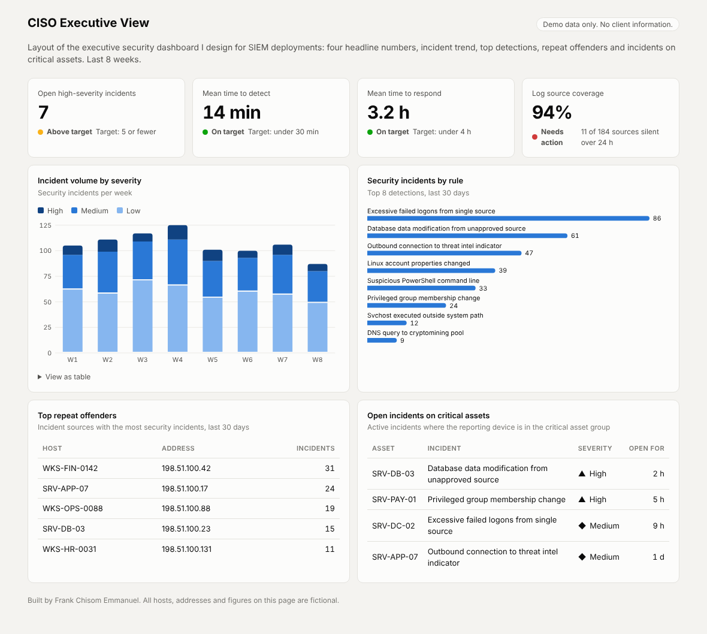

# Dashboards

## CISO Executive View

[`ciso-executive-view.html`](ciso-executive-view.html) is a self-contained HTML reproduction of the executive dashboard layout I design for SIEM deployments. **All data is fictional.** It has no external dependencies and supports light and dark mode.

Live: [princefrank0.github.io/Frank-Chisom-Emmanuel/dashboards/ciso-executive-view.html](https://princefrank0.github.io/Frank-Chisom-Emmanuel/dashboards/ciso-executive-view.html)

### Design

The dashboard answers four questions an executive asks, in order:

| Question | Widget |
|---|---|
| Are we within tolerance right now? | Four headline numbers with target status: open high-severity incidents, mean time to detect, mean time to respond, log source coverage |
| Is it getting better or worse? | Weekly incident volume by severity |
| What is driving the volume? | Security incidents by detection rule (top 8) |
| Where is the risk concentrated? | Top repeat offenders, and open incidents on critical assets |

### Building it in a SIEM

Each widget is backed by one saved report, built and tested before the widget is added:

1. Open high incidents: incident events, severity High, status Active, distinct count of incident ID.
2. Incident volume by severity: incident events grouped by severity category over time.
3. Security incidents by rule: security-category incidents grouped by rule name, top 10.
4. Top repeat offenders: security-category incidents grouped by incident source, top 10.
5. Critical asset incidents: active incidents where the reporting device is in the critical asset group. The asset group must exist in the CMDB first.
6. Log source coverage: devices with no events received in 24 hours against total onboarded devices.

Supporting dashboards split out business impact, compliance posture and detection health so the executive view stays at one screen.
